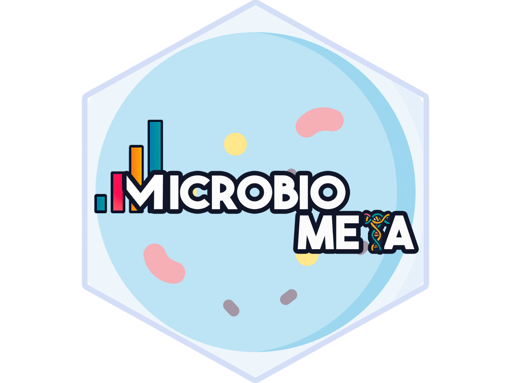

<!-- README.md is generated from README.Rmd. Please edit that file -->

# 🧬 MicroBioMeta 

<!-- badges: start -->

[](https://github.com/Steph0522/MicroBioMeta/actions/workflows/check-bioc.yml)
[](https://github.com/Steph0522/MicroBioMeta/issues)
[](https://github.com/Steph0522/MicroBioMeta/pulls)
[](https://github.com/Steph0522/MicroBioMeta/commits/devel)
[](https://lifecycle.r-lib.org/articles/stages.html#experimental)

<!-- badges: end -->

The goal of `MicroBioMeta` is to support beginners in microbiome data
analysis, whether working with metagenomic or metabarcoding datasets. It
enables users with limited experience in R to explore, visualize, and
analyze results with minimal coding and customization. This helps save
time on scripting, while still producing statistically robust results
and publication-ready figures in an intuitive and accessible way.

The functions take a feature table (taxa in rows, samples in columns,
with a `taxonomy` column at the end) and a metadata table (sample IDs in
the first column). They cover:

- **Composition**: bar plots, heatmaps and Sankey diagrams.
- **Alpha diversity**: Hill numbers, classic indices, diversity along
  continuous gradients and Venn diagrams.
- **Beta diversity**: ordinations, PERMANOVA/betadisper, turnover and
  nestedness partitions, and distance-decay.
- **Differential abundance**: ALDEx2, ANCOM-BC2, random forest and
  log-ratios.
- **Environmental variables**: correlations and CCA/RDA biplots.

## 💻 Installation

`MicroBioMeta` is not on Bioconductor yet. For now, install it from
GitHub:

``` r
# install.packages("remotes")
remotes::install_github("Steph0522/MicroBioMeta")
```

Once it is accepted in Bioconductor, it will be installed with:

``` r
if (!requireNamespace("BiocManager", quietly = TRUE)) {
    install.packages("BiocManager")
}
BiocManager::install("MicroBioMeta")
```

## 📗 Documentation

Tutorials in English and Spanish are on the [web
page](https://steph0522.github.io/MicroBioMeta/):

- [Metabarcoding](https://steph0522.github.io/MicroBioMeta/articles/metabarcoding.html)
  /
  [Amplicón](https://steph0522.github.io/MicroBioMeta/articles/metabarcoding_es.html)
- [Metagenomic](https://steph0522.github.io/MicroBioMeta/articles/metagenomic.html)
  /
  [Metagenómica](https://steph0522.github.io/MicroBioMeta/articles/metagenomic_es.html)

## 🧪 Example data

The package includes 16S and 18S metabarcoding data from *Ricinus
communis* soils and roots, and shotgun metagenomic (Kraken2/Bracken)
data from forest soils of Central Mexico, all from published studies.
Their sources and how they were prepared are described in
[`inst/script/README.md`](inst/script/README.md).

## 👩‍💻 Contributors

- Stephanie Hereira - lead developer.
- Nina Montoya - co-developer and functions.
- Karla Zarco - co-developer and functions.

## 🙌 Code of Conduct

Please note that the `MicroBioMeta` project is released with a
[Contributor Code of
Conduct](http://bioconductor.org/about/code-of-conduct/). By
contributing to this project, you agree to abide by its terms.

## 🔨 Development tools

- Continuous code testing is possible thanks to [GitHub
  actions](https://www.tidyverse.org/blog/2020/04/usethis-1-6-0/)
  through *[usethis](https://CRAN.R-project.org/package=usethis)*,
  *[remotes](https://CRAN.R-project.org/package=remotes)*, and
  *[rcmdcheck](https://CRAN.R-project.org/package=rcmdcheck)* customized
  to use [Bioconductor’s docker
  containers](https://www.bioconductor.org/help/docker/) and
  *[BiocCheck](https://bioconductor.org/packages/BiocCheck)*.
- Code coverage assessment is possible thanks to
  [codecov](https://codecov.io/gh) and
  *[covr](https://CRAN.R-project.org/package=covr)*.
- The [documentation website](https://steph0522.github.io/MicroBioMeta/)
  is built with *[pkgdown](https://CRAN.R-project.org/package=pkgdown)*.
- The code is styled with
  *[styler](https://CRAN.R-project.org/package=styler)*.
- The documentation is formatted thanks to
  *[devtools](https://CRAN.R-project.org/package=devtools)* and
  *[roxygen2](https://CRAN.R-project.org/package=roxygen2)*.

This package was developed using
*[biocthis](https://bioconductor.org/packages/biocthis)*.
