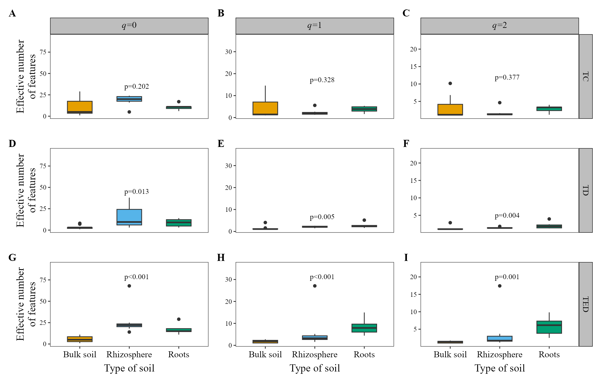
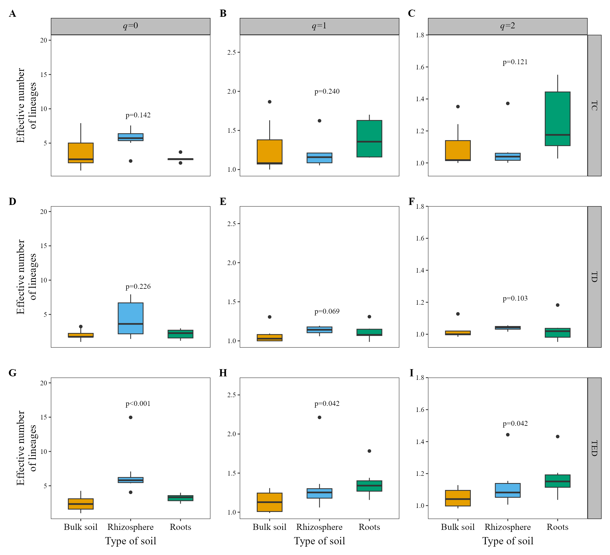
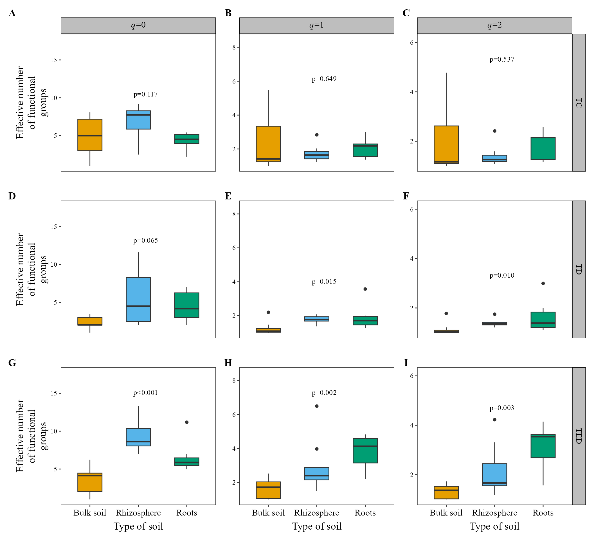
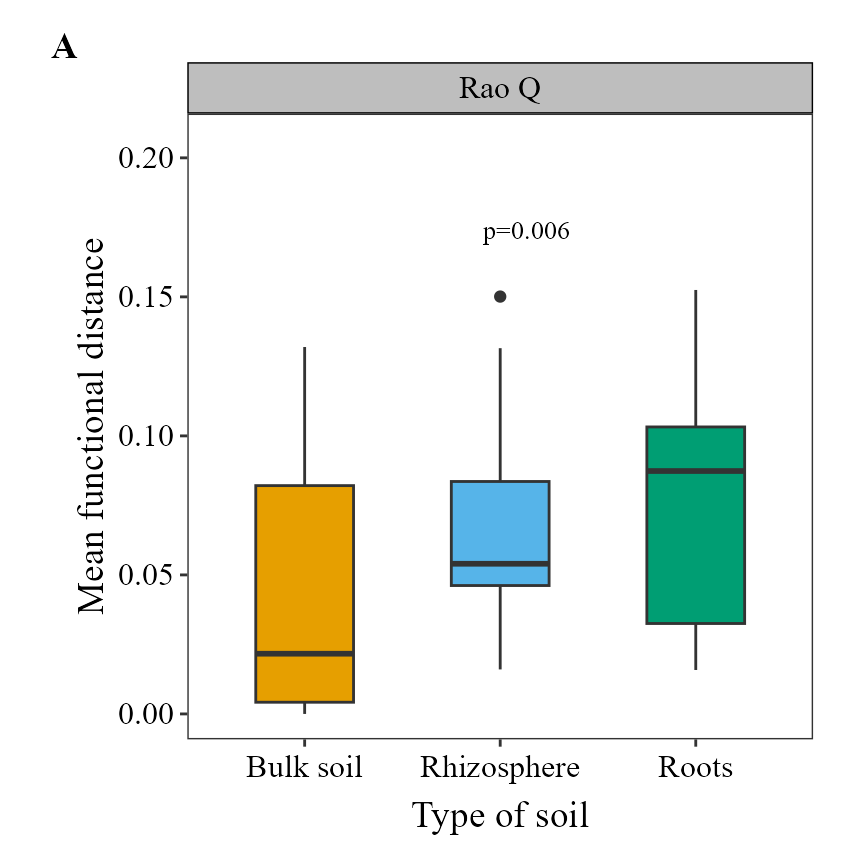
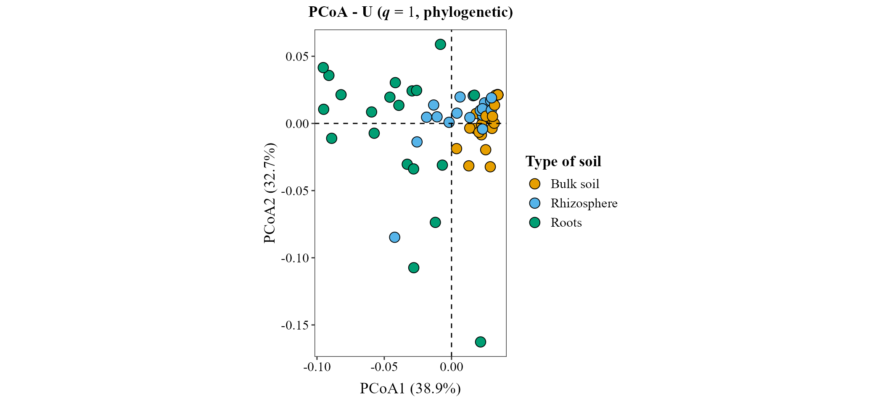
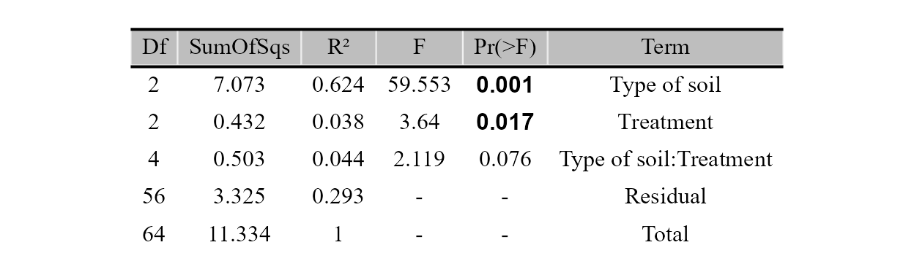
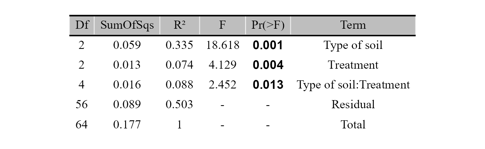
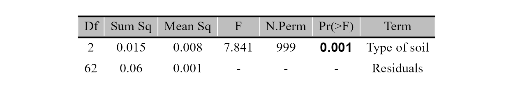

# Hill numbers: taxonomic, phylogenetic and functional diversity

`MicroBioMeta` computes diversity and returns the figure ready for
publication. This tutorial explains the Hill-number framework and how to
use it in the functions that work with it:
[`alpha_hill_plot()`](https://steph0522.github.io/MicroBioMeta/reference/alpha_hill_plot.md)
and
[`alpha_diversity_plot()`](https://steph0522.github.io/MicroBioMeta/reference/alpha_diversity_plot.md)
for alpha diversity, and
[`beta_ord_plot()`](https://steph0522.github.io/MicroBioMeta/reference/beta_ord_plot.md)
and
[`beta_test_table()`](https://steph0522.github.io/MicroBioMeta/reference/beta_test_table.md)
for beta diversity. The calculations with a tree or with traits come
from `hilldiv3` ([Alberdi and Gilbert 2019](#ref-alberdi2019guide)).

## Why Hill numbers

Hill numbers ([Hill 1973](#ref-hill1973diversity); [Jost
2007](#ref-jost2007partitioning)) express diversity as an **effective
number**: how many equally abundant taxa would give the same diversity
as the sample. A sample with a value of 10 is twice as diverse as one
with a value of 5, a statement that does not hold for the Shannon or
Simpson indices.

The order $`q`$ sets how much weight the abundances get:

| Order     | Weight of the taxa               | Equivalent to          |
|-----------|----------------------------------|------------------------|
| $`q = 0`$ | All count the same               | Richness               |
| $`q = 1`$ | In proportion to their abundance | Exponential of Shannon |
| $`q = 2`$ | Mostly the dominant ones         | Inverse of Simpson     |

The same idea extends to two other dimensions of diversity ([Chao et al.
2014](#ref-chao2014unifying)). All three are effective numbers, in
species or lineage equivalents ([Chao et al.
2021](#ref-chao2021measuring)), but they count different things: taxa,
lineages or functional groups. Always say which one you report.

| `diversity` | What it takes into account | What you need | Unit |
|----|----|----|----|
| `"taxonomic"` | Abundances | The table | Effective number of features |
| `"phylogenetic"` | How related the taxa are ([Chao et al. 2010](#ref-chao2010phylogenetic)) | Rooted tree | Effective number of lineages |
| `"functional"` | How different their traits are ([Chao et al. 2019](#ref-chao2019attribute)) | Traits per taxon | Effective number of functional groups |

## Preparing the data

We use the fungal example of the package (arbuscular mycorrhizal fungi,
18S).

``` r

library(MicroBioMeta)

table_fungi <- read.delim(
    system.file("extdata", "table_fungi.txt", package = "MicroBioMeta"),
    row.names = 1, check.names = FALSE
)
taxonomy_fungi <- read.delim(
    system.file("extdata", "taxonomy_fungi.txt", package = "MicroBioMeta"),
    check.names = FALSE
)
metadata_fungi <- read.delim(
    system.file("extdata", "metadata_fungi.txt", package = "MicroBioMeta"),
    check.names = FALSE
)
metadata_fungi <- metadata_fungi[metadata_fungi$SAMPLEID %in% colnames(table_fungi), ]
table_fungi <- table_fungi[, metadata_fungi$SAMPLEID]

table_fung <- merge_feature_taxonomy(table = table_fungi, taxonomy = taxonomy_fungi)
```

### The tree

The tip labels must be the taxa of the table. With QIIME 2 ([Bolyen et
al. 2019](#ref-bolyen2019qiime2)), the tree comes from the
representative sequences, and `exported-tree/tree.nwk` is what you read
in R:

``` bash
qiime phylogeny align-to-tree-mafft-fasttree \
    --i-sequences rep-seqs.qza \
    --output-dir phylogeny
qiime tools export --input-path phylogeny/rooted_tree.qza --output-path exported-tree
```

``` r

tree_fungi <- ape::read.tree(
    system.file("extdata", "tree_fungi.nwk", package = "MicroBioMeta")
)
```

Check the tree before you use it: a few spurious sequences on a very
long branch can flatten $`q = 1`$ and $`q = 2`$, because that branch
dominates the tree. In this example we removed three *Unassigned* ASVs
(10 reads) for that reason.

### The traits

`traits` is a table with taxa in rows and traits in columns. Any
measured trait works. For microbial communities a common source is the
table of gene families predicted per ASV by PICRUSt2 ([Douglas et al.
2020](#ref-douglas2020picrust2)), such as `EC_predicted.tsv`. Those are
predictions, not measurements, so report them as such.

``` r

traits_fungi <- read.delim(
    system.file("extdata", "traits_fungi.txt", package = "MicroBioMeta"),
    row.names = 1, check.names = FALSE
)
```

Taxa that are in the table but not in the tree or the traits are dropped
with a warning that says how many. Here that happens with the three ASVs
above.

## Alpha diversity with Hill numbers

[`alpha_hill_plot()`](https://steph0522.github.io/MicroBioMeta/reference/alpha_hill_plot.md)
uses the same call for all three types. Only `diversity` and its input
change, and the y-axis title follows the unit of each type.

``` r

alpha_hill_plot(
    table = table_fung,
    metadata = metadata_fungi,
    x_col = "Type_of_soil",
    fill_col = "Type_of_soil",
    facet_by = "Treatment",
    x_axis_title = "Type of soil",
    show_legend = FALSE,
    stat = "kruskal.test"
)
```



``` r

alpha_hill_plot(
    table = table_fung,
    metadata = metadata_fungi,
    x_col = "Type_of_soil",
    fill_col = "Type_of_soil",
    facet_by = "Treatment",
    x_axis_title = "Type of soil",
    show_legend = FALSE,
    stat = "kruskal.test",
    diversity = "phylogenetic",
    tree = tree_fungi
)
```



``` r

alpha_hill_plot(
    table = table_fung,
    metadata = metadata_fungi,
    x_col = "Type_of_soil",
    fill_col = "Type_of_soil",
    facet_by = "Treatment",
    x_axis_title = "Type of soil",
    show_legend = FALSE,
    stat = "kruskal.test",
    diversity = "functional",
    traits = traits_fungi
)
```



Two details of these values:

- The phylogenetic values are read at one common depth, the mean tree
  depth of the samples ([Chiu et al. 2014](#ref-chiu2014phylogenetic)),
  so samples are comparable. For that reason a sample can fall slightly
  below 1. `iNEXT.3D` uses the age of the root instead, so its values
  are not the same.
- Functional values depend on a threshold $`\tau`$: taxa at that
  distance or more count as different functional groups. By default it
  is the mean distance between two reads of the pooled samples ([Chao et
  al. 2019](#ref-chao2019attribute)), and you can change it with `tau`.

## Classic indices

[`alpha_diversity_plot()`](https://steph0522.github.io/MicroBioMeta/reference/alpha_diversity_plot.md)
shows the classic indices, also with `diversity`:

| `diversity` | Index | Meaning | Unit |
|----|----|----|----|
| `"taxonomic"` | Chao1, Shannon, Simpson | Richness and evenness | Different in each index |
| `"phylogenetic"` | Faith’s PD ([Faith 1992](#ref-faith1992conservation)) | Summed branch length up to the root | Branch length |
| `"functional"` | Rao’s Q ([Rao 1982](#ref-rao1982diversity)) | Mean distance between two random reads | Distance (Gower) |

``` r

alpha_diversity_plot(
    table = table_fung,
    metadata = metadata_fungi,
    x_col = "Type_of_soil",
    fill_col = "Type_of_soil",
    x_axis_title = "Type of soil",
    show_legend = FALSE,
    stat = "kruskal.test",
    diversity = "phylogenetic",
    tree = tree_fungi
)
```


``` r

alpha_diversity_plot(
    table = table_fung,
    metadata = metadata_fungi,
    x_col = "Type_of_soil",
    fill_col = "Type_of_soil",
    x_axis_title = "Type of soil",
    show_legend = FALSE,
    stat = "kruskal.test",
    diversity = "functional",
    traits = traits_fungi
)
```



These indices are related to the Hill numbers but they are not the same
quantity. Faith’s PD is the phylogenetic $`q = 0`$ before dividing by
the depth of the tree, and Rao’s Q gives the functional $`q = 2`$
through $`1 / (1 - Q / \tau)`$ when $`\tau`$ is the largest distance
between two taxa. Choose the classic index if you need to compare with
studies that report it, and the Hill number if you want every type in
the same framework.

## Beta diversity

### The metrics

[`hilldiv3::hillpair()`](https://alberdilab.github.io/hilldiv3/reference/hillpair.html)
turns the Hill numbers into dissimilarities between samples ([Jost
2007](#ref-jost2007partitioning); [Chiu et al.
2014](#ref-chiu2014phylogenetic); [Chao et al.
2023](#ref-chao2023rarefaction)). In `MicroBioMeta` they are one more
option of `distance`, next to `"jaccard"` or `"aitchison"`, with the
order set by `q`. They range from 0 (identical samples) to 1 (nothing
shared), so they have no unit problem.

| `distance` | Type | Taxonomic: $`q = 0`$, $`1`$, $`2`$ | Phylogenetic: $`q = 0`$, $`1`$, $`2`$ |
|----|----|----|----|
| `"U"` | Jaccard type | Jaccard, Horn, regional overlap | Phylo-Jaccard (unweighted UniFrac), phylo-Horn, phylo-regional-overlap |
| `"C"` | Sørensen type | Sørensen, Horn, Morisita-Horn | Phylo-Sørensen (PhyloSor), phylo-Horn, phylo-Morisita-Horn |
| `"S"` | Jaccard-type turnover | Jaccard, no name, Morisita-Horn | Phylo-Jaccard, no name, phylo-Morisita-Horn |
| `"V"` | Sørensen-type turnover | Sørensen, no name, no name | Phylo-Sørensen, no name, no name |

The phylogenetic names come from Chiu et al.
([2014](#ref-chiu2014phylogenetic)), and PhyloSor from Bryant et al.
([2008](#ref-bryant2008microbes)); UniFrac is from Lozupone and Knight
([2005](#ref-lozupone2005unifrac)). The functional versions have no
names of their own: Chao et al. ([2019](#ref-chao2019attribute)) calls
them Sørensen-type and Jaccard-type functional measures, so report them
that way, with $`q`$ and $`\tau`$. At $`q = 1`$, `"U"` is phylo-Horn,
not the weighted UniFrac.

These metrics describe the differences in Hill-number terms; they are
not compositional. If your main analysis uses CLR/Aitchison, keep it
there and use these as a complement.

### Ordination

The Hill metrics work with `ordination = "PCoA"` or `"NMDS"`, the same
as any distance that is not `"compositional"`.
[`beta_ord_plot()`](https://steph0522.github.io/MicroBioMeta/reference/beta_ord_plot.md)
keeps the same scale on both axes, so the plot gets flat when the first
axis explains most of the variation. In the functional example we add
[`ggplot2::coord_cartesian()`](https://ggplot2.tidyverse.org/reference/coord_cartesian.html)
to fill the figure; keep in mind that the axes no longer share a scale.

``` r

beta_ord_plot(
    table = table_fung,
    metadata = metadata_fungi,
    distance = "U",
    q = 1,
    ordination = "PCoA",
    group_col = "Type_of_soil",
    legend_title = "Type of soil"
)
```


``` r

beta_ord_plot(
    table = table_fung,
    metadata = metadata_fungi,
    distance = "U",
    q = 1,
    ordination = "PCoA",
    group_col = "Type_of_soil",
    legend_title = "Type of soil",
    diversity = "phylogenetic",
    tree = tree_fungi
)
```



``` r

beta_ord_plot(
    table = table_fung,
    metadata = metadata_fungi,
    distance = "U",
    q = 1,
    ordination = "PCoA",
    group_col = "Type_of_soil",
    legend_title = "Type of soil",
    diversity = "functional",
    traits = traits_fungi
) + ggplot2::coord_cartesian()
```


### PERMANOVA and betadisper

[`beta_test_table()`](https://steph0522.github.io/MicroBioMeta/reference/beta_test_table.md)
takes the same arguments. A PERMANOVA ([Anderson
2001](#ref-anderson2001permanova)) tests whether the groups differ, and
betadisper ([Anderson 2006](#ref-anderson2006distance)) whether their
dispersion does. Report both: a significant PERMANOVA with unequal
dispersions may reflect differences in dispersion, not in position.

We use $`q = 1`$ and the same model for all three types. At that order
soil and treatment differ in all of them, and the interaction only in
the phylogenetic one.

Taxonomic:

``` r

beta_test_table(
    table = table_fung,
    metadata = metadata_fungi,
    formula_str = "Type_of_soil * Treatment",
    distance = "U",
    q = 1
)
```



Phylogenetic:

``` r

beta_test_table(
    table = table_fung,
    metadata = metadata_fungi,
    formula_str = "Type_of_soil * Treatment",
    distance = "U",
    q = 1,
    diversity = "phylogenetic",
    tree = tree_fungi
)
```



Functional:

``` r

beta_test_table(
    table = table_fung,
    metadata = metadata_fungi,
    formula_str = "Type_of_soil * Treatment",
    distance = "U",
    q = 1,
    diversity = "functional",
    traits = traits_fungi
)
```


`test = "betadisper"` works the same way for the three types. Here is
the phylogenetic one. At $`q = 1`$ the dispersions differ between types
of soil in all three, so read the PERMANOVA of `Type_of_soil` with that
in mind.

``` r

beta_test_table(
    table = table_fung,
    metadata = metadata_fungi,
    formula_str = "Type_of_soil",
    distance = "U",
    q = 1,
    test = "betadisper",
    diversity = "phylogenetic",
    tree = tree_fungi
)
```



## References

Alberdi, Antton, and M. Thomas P. Gilbert. 2019. “A Guide to the
Application of Hill Numbers to DNA-Based Diversity Analyses.” *Molecular
Ecology Resources* 19 (4): 804–17.
<https://doi.org/10.1111/1755-0998.13014>.

Anderson, Marti J. 2001. “A New Method for Non-Parametric Multivariate
Analysis of Variance.” *Austral Ecology* 26 (1): 32–46.
<https://doi.org/10.1111/j.1442-9993.2001.01070.pp.x>.

Anderson, Marti J. 2006. “Distance-Based Tests for Homogeneity of
Multivariate Dispersions.” *Biometrics* 62 (1): 245–53.
<https://doi.org/10.1111/j.1541-0420.2005.00440.x>.

Bolyen, Evan, Jai Ram Rideout, Matthew R. Dillon, et al. 2019.
“Reproducible, Interactive, Scalable and Extensible Microbiome Data
Science Using QIIME 2.” *Nature Biotechnology* 37 (8): 852–57.
<https://doi.org/10.1038/s41587-019-0209-9>.

Bryant, Jessica A., Christine Lamanna, Hélène Morlon, Andrew J.
Kerkhoff, Brian J. Enquist, and Jessica L. Green. 2008. “Microbes on
Mountainsides: Contrasting Elevational Patterns of Bacterial and Plant
Diversity.” *Proceedings of the National Academy of Sciences* 105
(supplement_1): 11505–11. <https://doi.org/10.1073/pnas.0801920105>.

Chao, Anne, Chun-Huo Chiu, and Lou Jost. 2010. “Phylogenetic Diversity
Measures Based on Hill Numbers.” *Philosophical Transactions of the
Royal Society B: Biological Sciences* 365 (1558): 3599–609.
<https://doi.org/10.1098/rstb.2010.0272>.

Chao, Anne, Chun-Huo Chiu, and Lou Jost. 2014. “Unifying Species
Diversity, Phylogenetic Diversity, Functional Diversity, and Related
Similarity and Differentiation Measures Through Hill Numbers.” *Annual
Review of Ecology, Evolution, and Systematics* 45 (1): 297–324.
<https://doi.org/10.1146/annurev-ecolsys-120213-091540>.

Chao, Anne, Chun-Huo Chiu, Sébastien Villéger, et al. 2019. “An
Attribute-Diversity Approach to Functional Diversity, Functional Beta
Diversity, and Related (Dis)similarity Measures.” *Ecological
Monographs* 89 (2): e01343. <https://doi.org/10.1002/ecm.1343>.

Chao, Anne, Peter A. Henderson, Chun-Huo Chiu, et al. 2021. “Measuring
Temporal Change in Alpha Diversity: A Framework Integrating Taxonomic,
Phylogenetic and Functional Diversity and the iNEXT.3D Standardization.”
*Methods in Ecology and Evolution* 12 (10): 1926–40.
<https://doi.org/10.1111/2041-210X.13682>.

Chao, Anne, Simon Thorn, Chun-Huo Chiu, et al. 2023. “Rarefaction and
Extrapolation with Beta Diversity Under a Framework of Hill Numbers: The
iNEXT.beta3D Standardization.” *Ecological Monographs* 93 (4): e1588.
<https://doi.org/10.1002/ecm.1588>.

Chiu, Chun-Huo, Lou Jost, and Anne Chao. 2014. “Phylogenetic Beta
Diversity, Similarity, and Differentiation Measures Based on Hill
Numbers.” *Ecological Monographs* 84 (1): 21–44.
<https://doi.org/10.1890/12-0960.1>.

Douglas, Gavin M., Vincent J. Maffei, Jesse R. Zaneveld, et al. 2020.
“PICRUSt2 for Prediction of Metagenome Functions.” *Nature
Biotechnology* 38 (6): 685–88.
<https://doi.org/10.1038/s41587-020-0548-6>.

Faith, Daniel P. 1992. “Conservation Evaluation and Phylogenetic
Diversity.” *Biological Conservation* 61 (1): 1–10.
<https://doi.org/10.1016/0006-3207(92)91201-3>.

Hill, M. O. 1973. “Diversity and Evenness: A Unifying Notation and Its
Consequences.” *Ecology* 54 (2): 427–32.
<https://doi.org/10.2307/1934352>.

Jost, Lou. 2007. “Partitioning Diversity into Independent Alpha and Beta
Components.” *Ecology* 88 (10): 2427–39.
<https://doi.org/10.1890/06-1736.1>.

Lozupone, Catherine, and Rob Knight. 2005. “UniFrac: A New Phylogenetic
Method for Comparing Microbial Communities.” *Applied and Environmental
Microbiology* 71 (12): 8228–35.
<https://doi.org/10.1128/AEM.71.12.8228-8235.2005>.

Rao, C. Radhakrishna. 1982. “Diversity and Dissimilarity Coefficients: A
Unified Approach.” *Theoretical Population Biology* 21 (1): 24–43.
<https://doi.org/10.1016/0040-5809(82)90004-1>.

## Session info

``` r

sessionInfo()
```

    ## R version 4.6.1 (2026-06-24 ucrt)
    ## Platform: x86_64-w64-mingw32/x64
    ## Running under: Windows 10 x64 (build 19045)
    ## 
    ## Matrix products: default
    ##   LAPACK version 3.12.1
    ## 
    ## locale:
    ## [1] LC_COLLATE=Spanish_Latin America.utf8 
    ## [2] LC_CTYPE=Spanish_Latin America.utf8   
    ## [3] LC_MONETARY=Spanish_Latin America.utf8
    ## [4] LC_NUMERIC=C                          
    ## [5] LC_TIME=Spanish_Latin America.utf8    
    ## 
    ## time zone: America/Mexico_City
    ## tzcode source: internal
    ## 
    ## attached base packages:
    ## [1] stats     graphics  grDevices utils     datasets  methods   base     
    ## 
    ## other attached packages:
    ## [1] MicroBioMeta_0.99.0
    ## 
    ## loaded via a namespace (and not attached):
    ##   [1] deldir_2.0-4                gridExtra_2.3.1            
    ##   [3] permute_0.9-10              rlang_1.3.0                
    ##   [5] magrittr_2.0.5              otel_0.2.0                 
    ##   [7] matrixStats_1.5.0           compiler_4.6.1             
    ##   [9] mgcv_1.9-4                  hillR_0.5.2                
    ##  [11] png_0.1-9                   systemfonts_1.3.2          
    ##  [13] vctrs_0.7.3                 stringr_1.6.0              
    ##  [15] pkgconfig_2.0.3             fastmap_1.2.0              
    ##  [17] backports_1.5.1             XVector_0.52.0             
    ##  [19] labeling_0.4.3              rmarkdown_2.32             
    ##  [21] ragg_1.5.2                  purrr_1.2.2                
    ##  [23] xfun_0.61                   Rfast_2.1.5.2              
    ##  [25] randomForest_4.7-1.2        cachem_1.1.0               
    ##  [27] jsonlite_2.0.0              DelayedArray_0.38.2        
    ##  [29] BiocParallel_1.46.0         jpeg_0.1-11                
    ##  [31] broom_1.0.13                parallel_4.6.1             
    ##  [33] cluster_2.1.8.2             R6_2.6.1                   
    ##  [35] stringi_1.8.9               bslib_0.12.0               
    ##  [37] RColorBrewer_1.1-3          car_3.1-5                  
    ##  [39] zCompositions_1.6.2         GenomicRanges_1.64.0       
    ##  [41] jquerylib_0.1.4             Rcpp_1.1.2                 
    ##  [43] Seqinfo_1.2.0               SummarizedExperiment_1.42.0
    ##  [45] knitr_1.52                  hilldiv3_3.1.1             
    ##  [47] directlabels_2026.8.27      IRanges_2.46.0             
    ##  [49] Matrix_1.7-5                splines_4.6.1              
    ##  [51] tidyselect_1.2.1            dichromat_2.0-1            
    ##  [53] abind_1.4-8                 yaml_2.3.12                
    ##  [55] ggVennDiagram_1.5.7         vegan_2.7-6                
    ##  [57] codetools_0.2-20            lattice_0.22-9             
    ##  [59] tibble_3.3.1                Biobase_2.72.0             
    ##  [61] withr_3.0.3                 S7_0.2.2                   
    ##  [63] evaluate_1.0.5              desc_1.4.3                 
    ##  [65] survival_3.8-6              RcppParallel_6.2.1         
    ##  [67] pillar_1.11.1               ggpubr_1.0.0               
    ##  [69] MatrixGenerics_1.24.0       carData_3.0-6              
    ##  [71] stats4_4.6.1                NADA_1.6-1.2               
    ##  [73] generics_0.1.4              truncnorm_1.0-9            
    ##  [75] S4Vectors_0.50.3            ggplot2_4.0.3              
    ##  [77] scales_1.4.0                ALDEx2_1.44.0              
    ##  [79] glue_1.8.1                  tools_4.6.1                
    ##  [81] interp_1.1-6                data.table_1.18.6.1        
    ##  [83] ggsignif_0.6.4              ggvenn_0.1.19              
    ##  [85] fs_2.1.0                    cowplot_1.2.0              
    ##  [87] grid_4.6.1                  tidyr_1.3.2                
    ##  [89] ape_5.8-1                   latticeExtra_0.6-31        
    ##  [91] nlme_3.1-169                patchwork_1.3.2            
    ##  [93] Formula_1.2-6               cli_3.6.6                  
    ##  [95] zigg_0.0.2                  textshaping_1.0.5          
    ##  [97] S4Arrays_1.12.0             dplyr_1.2.1                
    ##  [99] gtable_0.3.6                ggh4x_0.3.1                
    ## [101] rstatix_1.1.0               sass_0.4.10                
    ## [103] digest_0.6.39               progressr_1.0.0            
    ## [105] BiocGenerics_0.58.1         SparseArray_1.12.2         
    ## [107] ggrepel_0.9.8               htmlwidgets_1.6.4          
    ## [109] farver_2.1.2                htmltools_0.5.9            
    ## [111] pkgdown_2.2.1               lifecycle_1.0.5            
    ## [113] MASS_7.3-65
