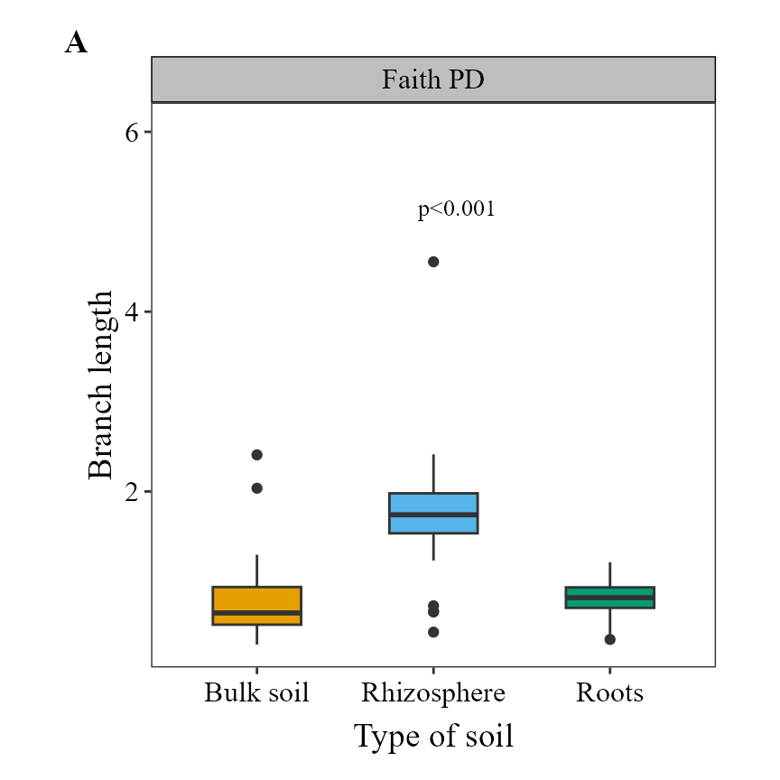
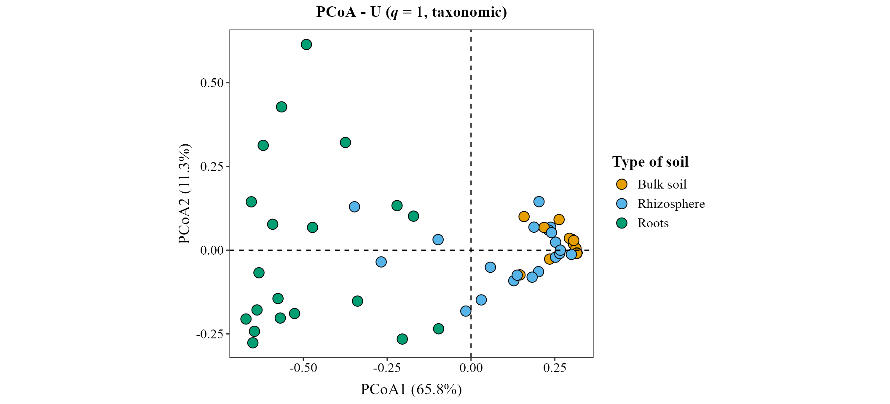
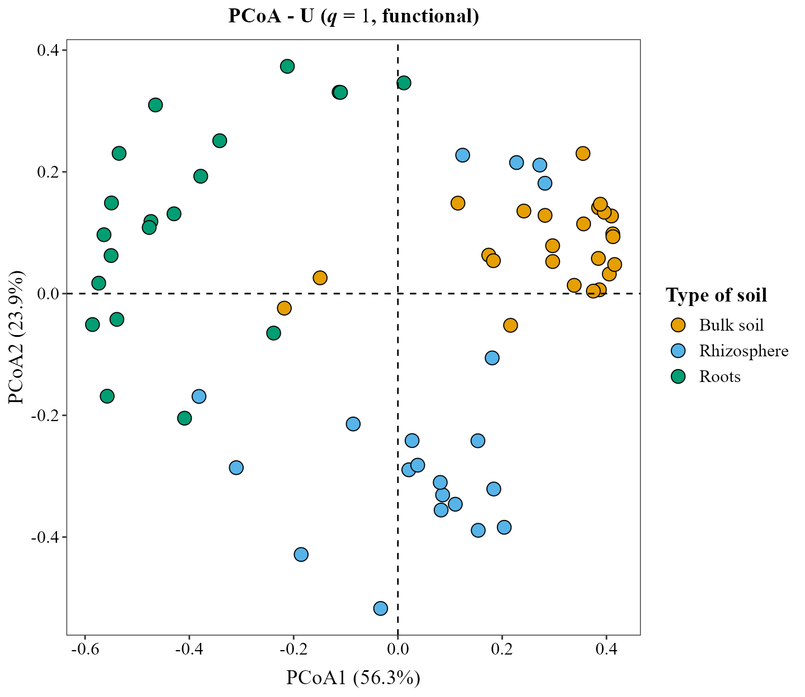
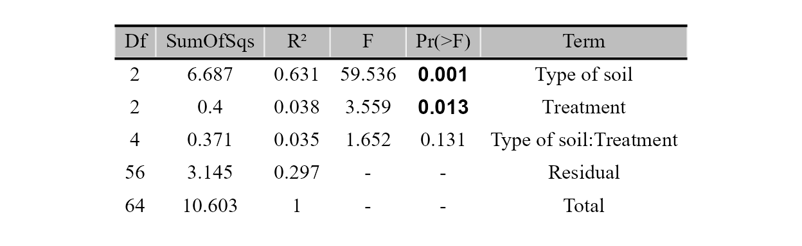

# Números de Hill: diversidad taxonómica, filogenética y funcional

`MicroBioMeta` calcula la diversidad y devuelve la figura lista para
publicar. Este tutorial explica el marco de los números de Hill y cómo
usarlo en las funciones que trabajan con él:
[`alpha_hill_plot()`](https://steph0522.github.io/MicroBioMeta/reference/alpha_hill_plot.md)
y
[`alpha_diversity_plot()`](https://steph0522.github.io/MicroBioMeta/reference/alpha_diversity_plot.md)
para diversidad alfa, y
[`beta_ord_plot()`](https://steph0522.github.io/MicroBioMeta/reference/beta_ord_plot.md)
y
[`beta_test_table()`](https://steph0522.github.io/MicroBioMeta/reference/beta_test_table.md)
para diversidad beta. Los cálculos con árbol o con rasgos vienen de
`hilldiv3` ([Alberdi and Gilbert 2019](#ref-alberdi2019guide)).

## Por qué números de Hill

Los números de Hill ([Hill 1973](#ref-hill1973diversity); [Jost
2007](#ref-jost2007partitioning)) expresan la diversidad como un
**número efectivo**: cuántos taxones igual de abundantes darían la misma
diversidad que la muestra. Una muestra con valor 10 es el doble de
diversa que una con valor 5, algo que no se cumple con los índices de
Shannon o Simpson.

El orden $`q`$ define cuánto peso reciben las abundancias:

| Orden     | Peso de los taxones          | Equivale a             |
|-----------|------------------------------|------------------------|
| $`q = 0`$ | Todos cuentan igual          | Riqueza                |
| $`q = 1`$ | Proporcional a su abundancia | Exponencial de Shannon |
| $`q = 2`$ | Sobre todo los dominantes    | Inverso de Simpson     |

La misma idea se extiende a otras dos dimensiones de la diversidad
([Chao et al. 2014](#ref-chao2014unifying)). Las tres son números
efectivos, en equivalentes de especies o linajes ([Chao et al.
2021](#ref-chao2021measuring)), pero cuentan cosas distintas: taxones,
linajes o grupos funcionales. Di siempre cuál reportas.

| `diversity` | Qué toma en cuenta | Qué necesitas | Unidad |
|----|----|----|----|
| `"taxonomic"` | Abundancias | La tabla | Número efectivo de features |
| `"phylogenetic"` | Qué tan emparentados están los taxones ([Chao et al. 2010](#ref-chao2010phylogenetic)) | Árbol enraizado | Número efectivo de linajes |
| `"functional"` | Qué tan distintos son sus rasgos ([Chao et al. 2019](#ref-chao2019attribute)) | Rasgos por taxón | Número efectivo de grupos funcionales |

## Preparar los datos

Usamos el ejemplo de hongos del paquete (hongos micorrízicos
arbusculares, 18S).

``` r

library(MicroBioMeta)

table_fungi <- read.delim(
    system.file("extdata", "table_fungi.txt", package = "MicroBioMeta"),
    row.names = 1, check.names = FALSE
)
taxonomy_fungi <- read.delim(
    system.file("extdata", "taxonomy_fungi.txt", package = "MicroBioMeta"),
    check.names = FALSE
)
metadata_fungi <- read.delim(
    system.file("extdata", "metadata_fungi.txt", package = "MicroBioMeta"),
    check.names = FALSE
)
metadata_fungi <- metadata_fungi[metadata_fungi$SAMPLEID %in% colnames(table_fungi), ]
table_fungi <- table_fungi[, metadata_fungi$SAMPLEID]

table_fung <- merge_feature_taxonomy(table = table_fungi, taxonomy = taxonomy_fungi)
```

### El árbol

Las puntas del árbol deben ser los taxones de la tabla. Con QIIME 2
([Bolyen et al. 2019](#ref-bolyen2019qiime2)), el árbol sale de las
secuencias representativas, y `exported-tree/tree.nwk` es lo que lees en
R:

``` bash
qiime phylogeny align-to-tree-mafft-fasttree \
    --i-sequences rep-seqs.qza \
    --output-dir phylogeny
qiime tools export --input-path phylogeny/rooted_tree.qza --output-path exported-tree
```

``` r

tree_fungi <- ape::read.tree(
    system.file("extdata", "tree_fungi.nwk", package = "MicroBioMeta")
)
```

Revisa el árbol antes de usarlo: unas pocas secuencias espurias en una
rama muy larga pueden aplanar $`q = 1`$ y $`q = 2`$, porque esa rama
domina el árbol. En este ejemplo quitamos tres ASVs *Unassigned* (10
lecturas) por esa razón.

### Los rasgos

`traits` es una tabla con taxones en filas y rasgos en columnas. Sirve
cualquier rasgo medido. En comunidades microbianas, una fuente común es
la tabla de familias de genes predichas por ASV con PICRUSt2 ([Douglas
et al. 2020](#ref-douglas2020picrust2)), como `EC_predicted.tsv`. Son
predicciones, no mediciones, así que repórtalas como tales.

``` r

traits_fungi <- read.delim(
    system.file("extdata", "traits_fungi.txt", package = "MicroBioMeta"),
    row.names = 1, check.names = FALSE
)
```

Los taxones que están en la tabla pero no en el árbol o en los rasgos se
descartan con un aviso que dice cuántos son. Aquí pasa con los tres ASVs
de arriba.

## Diversidad alfa con números de Hill

[`alpha_hill_plot()`](https://steph0522.github.io/MicroBioMeta/reference/alpha_hill_plot.md)
usa la misma llamada para los tres tipos. Solo cambian `diversity` y su
insumo, y el título del eje y sigue la unidad de cada tipo.

``` r

alpha_hill_plot(
    table = table_fung,
    metadata = metadata_fungi,
    x_col = "Type_of_soil",
    fill_col = "Type_of_soil",
    facet_by = "Treatment",
    x_axis_title = "Type of soil",
    show_legend = FALSE,
    stat = "kruskal.test"
)
```


``` r

alpha_hill_plot(
    table = table_fung,
    metadata = metadata_fungi,
    x_col = "Type_of_soil",
    fill_col = "Type_of_soil",
    facet_by = "Treatment",
    x_axis_title = "Type of soil",
    show_legend = FALSE,
    stat = "kruskal.test",
    diversity = "phylogenetic",
    tree = tree_fungi
)
```


``` r

alpha_hill_plot(
    table = table_fung,
    metadata = metadata_fungi,
    x_col = "Type_of_soil",
    fill_col = "Type_of_soil",
    facet_by = "Treatment",
    x_axis_title = "Type of soil",
    show_legend = FALSE,
    stat = "kruskal.test",
    diversity = "functional",
    traits = traits_fungi
)
```


Dos detalles de estos valores:

- Los valores filogenéticos se leen a una misma profundidad, la
  profundidad media del árbol en las muestras ([Chiu et al.
  2014](#ref-chiu2014phylogenetic)), para que las muestras sean
  comparables. Por eso una muestra puede quedar apenas por debajo de 1.
  `iNEXT.3D` usa en cambio la edad de la raíz, así que sus valores no
  son iguales.
- Los valores funcionales dependen de un umbral $`\tau`$: los taxones a
  esa distancia o más cuentan como grupos funcionales distintos. Por
  defecto es la distancia media entre dos lecturas de las muestras
  juntas ([Chao et al. 2019](#ref-chao2019attribute)), y puedes
  cambiarlo con `tau`.

## Índices clásicos

[`alpha_diversity_plot()`](https://steph0522.github.io/MicroBioMeta/reference/alpha_diversity_plot.md)
muestra los índices clásicos, también con `diversity`:

| `diversity` | Índice | Significado | Unidad |
|----|----|----|----|
| `"taxonomic"` | Chao1, Shannon, Simpson | Riqueza y equitatividad | Distinta en cada índice |
| `"phylogenetic"` | PD de Faith ([Faith 1992](#ref-faith1992conservation)) | Suma de longitudes de rama hasta la raíz | Longitud de rama |
| `"functional"` | Q de Rao ([Rao 1982](#ref-rao1982diversity)) | Distancia media entre dos lecturas al azar | Distancia (Gower) |

``` r

alpha_diversity_plot(
    table = table_fung,
    metadata = metadata_fungi,
    x_col = "Type_of_soil",
    fill_col = "Type_of_soil",
    x_axis_title = "Type of soil",
    show_legend = FALSE,
    stat = "kruskal.test",
    diversity = "phylogenetic",
    tree = tree_fungi
)
```



``` r

alpha_diversity_plot(
    table = table_fung,
    metadata = metadata_fungi,
    x_col = "Type_of_soil",
    fill_col = "Type_of_soil",
    x_axis_title = "Type of soil",
    show_legend = FALSE,
    stat = "kruskal.test",
    diversity = "functional",
    traits = traits_fungi
)
```


Estos índices se relacionan con los números de Hill, pero no son la
misma cantidad. El PD de Faith es el $`q = 0`$ filogenético antes de
dividir entre la profundidad del árbol, y la Q de Rao da el $`q = 2`$
funcional mediante $`1 / (1 - Q / \tau)`$ cuando $`\tau`$ es la mayor
distancia entre dos taxones. Elige el índice clásico si necesitas
comparar con estudios que lo reportan, y el número de Hill si quieres
todos los tipos en un mismo marco.

## Diversidad beta

### Las métricas

[`hilldiv3::hillpair()`](https://alberdilab.github.io/hilldiv3/reference/hillpair.html)
convierte los números de Hill en disimilitudes entre muestras ([Jost
2007](#ref-jost2007partitioning); [Chiu et al.
2014](#ref-chiu2014phylogenetic); [Chao et al.
2023](#ref-chao2023rarefaction)). En `MicroBioMeta` son una opción más
de `distance`, junto a `"jaccard"` o `"aitchison"`, con el orden
definido por `q`. Van de 0 (muestras idénticas) a 1 (nada compartido),
así que no tienen problema de unidades.

| `distance` | Tipo | Taxonómica: $`q = 0`$, $`1`$, $`2`$ | Filogenética: $`q = 0`$, $`1`$, $`2`$ |
|----|----|----|----|
| `"U"` | Tipo Jaccard | Jaccard, Horn, solapamiento regional | Phylo-Jaccard (UniFrac no ponderado), phylo-Horn, phylo-regional-overlap |
| `"C"` | Tipo Sørensen | Sørensen, Horn, Morisita-Horn | Phylo-Sørensen (PhyloSor), phylo-Horn, phylo-Morisita-Horn |
| `"S"` | Recambio tipo Jaccard | Jaccard, sin nombre, Morisita-Horn | Phylo-Jaccard, sin nombre, phylo-Morisita-Horn |
| `"V"` | Recambio tipo Sørensen | Sørensen, sin nombre, sin nombre | Phylo-Sørensen, sin nombre, sin nombre |

Los nombres filogenéticos vienen de Chiu et al.
([2014](#ref-chiu2014phylogenetic)), y PhyloSor de Bryant et al.
([2008](#ref-bryant2008microbes)); UniFrac es de Lozupone and Knight
([2005](#ref-lozupone2005unifrac)). Las versiones funcionales no tienen
nombres propios: Chao et al. ([2019](#ref-chao2019attribute)) las llama
medidas funcionales tipo Sørensen y tipo Jaccard, así que repórtalas
así, con $`q`$ y $`\tau`$. En $`q = 1`$, `"U"` es phylo-Horn, no el
UniFrac ponderado.

Estas métricas describen las diferencias en términos de números de Hill;
no son composicionales. Si tu análisis principal usa CLR/Aitchison,
mantenlo y usa estas como complemento.

### Ordenación

Las métricas de Hill funcionan con `ordination = "PCoA"` o `"NMDS"`,
igual que cualquier distancia que no sea `"compositional"`.
[`beta_ord_plot()`](https://steph0522.github.io/MicroBioMeta/reference/beta_ord_plot.md)
mantiene la misma escala en los dos ejes, así que la gráfica se achata
cuando el primer eje explica casi toda la variación. En el ejemplo
funcional agregamos
[`ggplot2::coord_cartesian()`](https://ggplot2.tidyverse.org/reference/coord_cartesian.html)
para llenar la figura; ten en cuenta que los ejes ya no comparten
escala.

``` r

beta_ord_plot(
    table = table_fung,
    metadata = metadata_fungi,
    distance = "U",
    q = 1,
    ordination = "PCoA",
    group_col = "Type_of_soil",
    legend_title = "Type of soil"
)
```



``` r

beta_ord_plot(
    table = table_fung,
    metadata = metadata_fungi,
    distance = "U",
    q = 1,
    ordination = "PCoA",
    group_col = "Type_of_soil",
    legend_title = "Type of soil",
    diversity = "phylogenetic",
    tree = tree_fungi
)
```


``` r

beta_ord_plot(
    table = table_fung,
    metadata = metadata_fungi,
    distance = "U",
    q = 1,
    ordination = "PCoA",
    group_col = "Type_of_soil",
    legend_title = "Type of soil",
    diversity = "functional",
    traits = traits_fungi
) + ggplot2::coord_cartesian()
```



### PERMANOVA y betadisper

[`beta_test_table()`](https://steph0522.github.io/MicroBioMeta/reference/beta_test_table.md)
recibe los mismos argumentos. Un PERMANOVA ([Anderson
2001](#ref-anderson2001permanova)) prueba si los grupos difieren, y
betadisper ([Anderson 2006](#ref-anderson2006distance)) si difiere su
dispersión. Reporta ambos: un PERMANOVA significativo con dispersiones
desiguales puede reflejar diferencias de dispersión, no de posición.

Usamos $`q = 1`$ y el mismo modelo para los tres tipos. En ese orden el
suelo y el tratamiento difieren en todos, y la interacción solo en el
filogenético.

Taxonómica:

``` r

beta_test_table(
    table = table_fung,
    metadata = metadata_fungi,
    formula_str = "Type_of_soil * Treatment",
    distance = "U",
    q = 1
)
```


Filogenética:

``` r

beta_test_table(
    table = table_fung,
    metadata = metadata_fungi,
    formula_str = "Type_of_soil * Treatment",
    distance = "U",
    q = 1,
    diversity = "phylogenetic",
    tree = tree_fungi
)
```


Funcional:

``` r

beta_test_table(
    table = table_fung,
    metadata = metadata_fungi,
    formula_str = "Type_of_soil * Treatment",
    distance = "U",
    q = 1,
    diversity = "functional",
    traits = traits_fungi
)
```



`test = "betadisper"` funciona igual para los tres tipos. Aquí está el
filogenético. En $`q = 1`$ las dispersiones difieren entre tipos de
suelo en los tres, así que lee el PERMANOVA de `Type_of_soil` con eso en
mente.

``` r

beta_test_table(
    table = table_fung,
    metadata = metadata_fungi,
    formula_str = "Type_of_soil",
    distance = "U",
    q = 1,
    test = "betadisper",
    diversity = "phylogenetic",
    tree = tree_fungi
)
```


## Referencias

Alberdi, Antton, and M. Thomas P. Gilbert. 2019. “A Guide to the
Application of Hill Numbers to DNA-Based Diversity Analyses.” *Molecular
Ecology Resources* 19 (4): 804–17.
<https://doi.org/10.1111/1755-0998.13014>.

Anderson, Marti J. 2001. “A New Method for Non-Parametric Multivariate
Analysis of Variance.” *Austral Ecology* 26 (1): 32–46.
<https://doi.org/10.1111/j.1442-9993.2001.01070.pp.x>.

Anderson, Marti J. 2006. “Distance-Based Tests for Homogeneity of
Multivariate Dispersions.” *Biometrics* 62 (1): 245–53.
<https://doi.org/10.1111/j.1541-0420.2005.00440.x>.

Bolyen, Evan, Jai Ram Rideout, Matthew R. Dillon, et al. 2019.
“Reproducible, Interactive, Scalable and Extensible Microbiome Data
Science Using QIIME 2.” *Nature Biotechnology* 37 (8): 852–57.
<https://doi.org/10.1038/s41587-019-0209-9>.

Bryant, Jessica A., Christine Lamanna, Hélène Morlon, Andrew J.
Kerkhoff, Brian J. Enquist, and Jessica L. Green. 2008. “Microbes on
Mountainsides: Contrasting Elevational Patterns of Bacterial and Plant
Diversity.” *Proceedings of the National Academy of Sciences* 105
(supplement_1): 11505–11. <https://doi.org/10.1073/pnas.0801920105>.

Chao, Anne, Chun-Huo Chiu, and Lou Jost. 2010. “Phylogenetic Diversity
Measures Based on Hill Numbers.” *Philosophical Transactions of the
Royal Society B: Biological Sciences* 365 (1558): 3599–609.
<https://doi.org/10.1098/rstb.2010.0272>.

Chao, Anne, Chun-Huo Chiu, and Lou Jost. 2014. “Unifying Species
Diversity, Phylogenetic Diversity, Functional Diversity, and Related
Similarity and Differentiation Measures Through Hill Numbers.” *Annual
Review of Ecology, Evolution, and Systematics* 45 (1): 297–324.
<https://doi.org/10.1146/annurev-ecolsys-120213-091540>.

Chao, Anne, Chun-Huo Chiu, Sébastien Villéger, et al. 2019. “An
Attribute-Diversity Approach to Functional Diversity, Functional Beta
Diversity, and Related (Dis)similarity Measures.” *Ecological
Monographs* 89 (2): e01343. <https://doi.org/10.1002/ecm.1343>.

Chao, Anne, Peter A. Henderson, Chun-Huo Chiu, et al. 2021. “Measuring
Temporal Change in Alpha Diversity: A Framework Integrating Taxonomic,
Phylogenetic and Functional Diversity and the iNEXT.3D Standardization.”
*Methods in Ecology and Evolution* 12 (10): 1926–40.
<https://doi.org/10.1111/2041-210X.13682>.

Chao, Anne, Simon Thorn, Chun-Huo Chiu, et al. 2023. “Rarefaction and
Extrapolation with Beta Diversity Under a Framework of Hill Numbers: The
iNEXT.beta3D Standardization.” *Ecological Monographs* 93 (4): e1588.
<https://doi.org/10.1002/ecm.1588>.

Chiu, Chun-Huo, Lou Jost, and Anne Chao. 2014. “Phylogenetic Beta
Diversity, Similarity, and Differentiation Measures Based on Hill
Numbers.” *Ecological Monographs* 84 (1): 21–44.
<https://doi.org/10.1890/12-0960.1>.

Douglas, Gavin M., Vincent J. Maffei, Jesse R. Zaneveld, et al. 2020.
“PICRUSt2 for Prediction of Metagenome Functions.” *Nature
Biotechnology* 38 (6): 685–88.
<https://doi.org/10.1038/s41587-020-0548-6>.

Faith, Daniel P. 1992. “Conservation Evaluation and Phylogenetic
Diversity.” *Biological Conservation* 61 (1): 1–10.
<https://doi.org/10.1016/0006-3207(92)91201-3>.

Hill, M. O. 1973. “Diversity and Evenness: A Unifying Notation and Its
Consequences.” *Ecology* 54 (2): 427–32.
<https://doi.org/10.2307/1934352>.

Jost, Lou. 2007. “Partitioning Diversity into Independent Alpha and Beta
Components.” *Ecology* 88 (10): 2427–39.
<https://doi.org/10.1890/06-1736.1>.

Lozupone, Catherine, and Rob Knight. 2005. “UniFrac: A New Phylogenetic
Method for Comparing Microbial Communities.” *Applied and Environmental
Microbiology* 71 (12): 8228–35.
<https://doi.org/10.1128/AEM.71.12.8228-8235.2005>.

Rao, C. Radhakrishna. 1982. “Diversity and Dissimilarity Coefficients: A
Unified Approach.” *Theoretical Population Biology* 21 (1): 24–43.
<https://doi.org/10.1016/0040-5809(82)90004-1>.

## Información de la sesión

``` r

sessionInfo()
```

    ## R version 4.6.1 (2026-06-24 ucrt)
    ## Platform: x86_64-w64-mingw32/x64
    ## Running under: Windows 10 x64 (build 19045)
    ## 
    ## Matrix products: default
    ##   LAPACK version 3.12.1
    ## 
    ## locale:
    ## [1] LC_COLLATE=Spanish_Latin America.utf8 
    ## [2] LC_CTYPE=Spanish_Latin America.utf8   
    ## [3] LC_MONETARY=Spanish_Latin America.utf8
    ## [4] LC_NUMERIC=C                          
    ## [5] LC_TIME=Spanish_Latin America.utf8    
    ## 
    ## time zone: America/Mexico_City
    ## tzcode source: internal
    ## 
    ## attached base packages:
    ## [1] stats     graphics  grDevices utils     datasets  methods   base     
    ## 
    ## other attached packages:
    ## [1] MicroBioMeta_0.99.0
    ## 
    ## loaded via a namespace (and not attached):
    ##   [1] deldir_2.0-4                gridExtra_2.3.1            
    ##   [3] permute_0.9-10              rlang_1.3.0                
    ##   [5] magrittr_2.0.5              otel_0.2.0                 
    ##   [7] matrixStats_1.5.0           compiler_4.6.1             
    ##   [9] mgcv_1.9-4                  hillR_0.5.2                
    ##  [11] png_0.1-9                   systemfonts_1.3.2          
    ##  [13] vctrs_0.7.3                 stringr_1.6.0              
    ##  [15] pkgconfig_2.0.3             fastmap_1.2.0              
    ##  [17] backports_1.5.1             XVector_0.52.0             
    ##  [19] labeling_0.4.3              rmarkdown_2.32             
    ##  [21] ragg_1.5.2                  purrr_1.2.2                
    ##  [23] xfun_0.61                   Rfast_2.1.5.2              
    ##  [25] randomForest_4.7-1.2        cachem_1.1.0               
    ##  [27] jsonlite_2.0.0              DelayedArray_0.38.2        
    ##  [29] BiocParallel_1.46.0         jpeg_0.1-11                
    ##  [31] broom_1.0.13                parallel_4.6.1             
    ##  [33] cluster_2.1.8.2             R6_2.6.1                   
    ##  [35] stringi_1.8.9               bslib_0.12.0               
    ##  [37] RColorBrewer_1.1-3          car_3.1-5                  
    ##  [39] zCompositions_1.6.2         GenomicRanges_1.64.0       
    ##  [41] jquerylib_0.1.4             Rcpp_1.1.2                 
    ##  [43] Seqinfo_1.2.0               SummarizedExperiment_1.42.0
    ##  [45] knitr_1.52                  hilldiv3_3.1.1             
    ##  [47] directlabels_2026.8.27      IRanges_2.46.0             
    ##  [49] Matrix_1.7-5                splines_4.6.1              
    ##  [51] tidyselect_1.2.1            dichromat_2.0-1            
    ##  [53] abind_1.4-8                 yaml_2.3.12                
    ##  [55] ggVennDiagram_1.5.7         vegan_2.7-6                
    ##  [57] codetools_0.2-20            lattice_0.22-9             
    ##  [59] tibble_3.3.1                Biobase_2.72.0             
    ##  [61] withr_3.0.3                 S7_0.2.2                   
    ##  [63] evaluate_1.0.5              desc_1.4.3                 
    ##  [65] survival_3.8-6              RcppParallel_6.2.1         
    ##  [67] pillar_1.11.1               ggpubr_1.0.0               
    ##  [69] MatrixGenerics_1.24.0       carData_3.0-6              
    ##  [71] stats4_4.6.1                NADA_1.6-1.2               
    ##  [73] generics_0.1.4              truncnorm_1.0-9            
    ##  [75] S4Vectors_0.50.3            ggplot2_4.0.3              
    ##  [77] scales_1.4.0                ALDEx2_1.44.0              
    ##  [79] glue_1.8.1                  tools_4.6.1                
    ##  [81] interp_1.1-6                data.table_1.18.6.1        
    ##  [83] ggsignif_0.6.4              ggvenn_0.1.19              
    ##  [85] fs_2.1.0                    cowplot_1.2.0              
    ##  [87] grid_4.6.1                  tidyr_1.3.2                
    ##  [89] ape_5.8-1                   latticeExtra_0.6-31        
    ##  [91] nlme_3.1-169                patchwork_1.3.2            
    ##  [93] Formula_1.2-6               cli_3.6.6                  
    ##  [95] zigg_0.0.2                  textshaping_1.0.5          
    ##  [97] S4Arrays_1.12.0             dplyr_1.2.1                
    ##  [99] gtable_0.3.6                ggh4x_0.3.1                
    ## [101] rstatix_1.1.0               sass_0.4.10                
    ## [103] digest_0.6.39               progressr_1.0.0            
    ## [105] BiocGenerics_0.58.1         SparseArray_1.12.2         
    ## [107] ggrepel_0.9.8               htmlwidgets_1.6.4          
    ## [109] farver_2.1.2                htmltools_0.5.9            
    ## [111] pkgdown_2.2.1               lifecycle_1.0.5            
    ## [113] MASS_7.3-65
